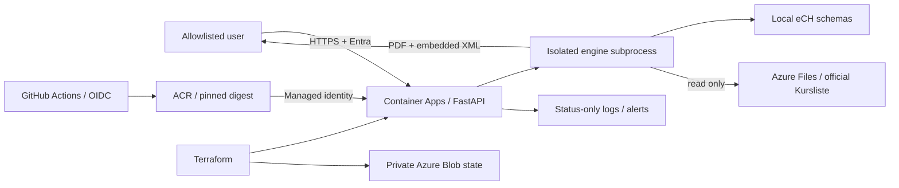
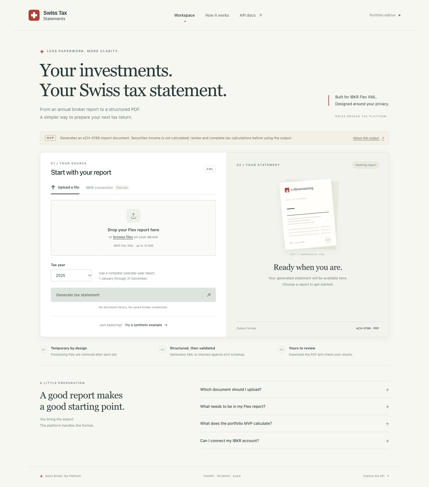
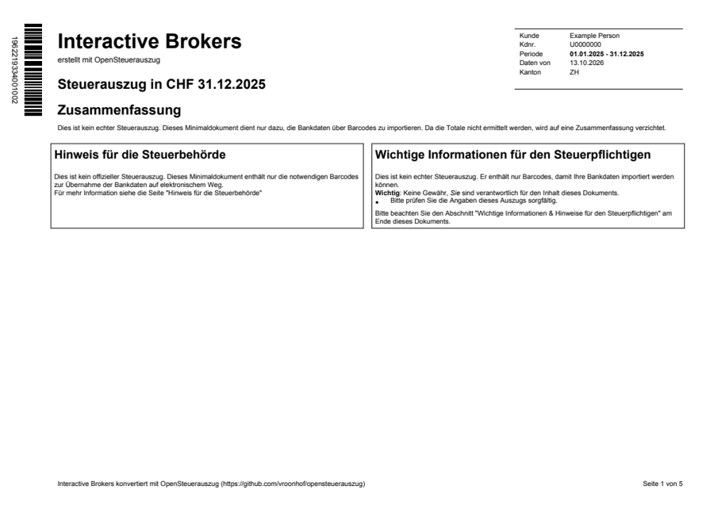

# Swiss Broker Tax Platform

An authenticated platform for converting **international broker exports → Swiss
tax-statement PDFs**. Currently supports **Interactive Brokers** annual Flex XML
exports, with additional broker integrations planned.
The service is deployed on Azure Container Apps and managed with Terraform.
A platform-engineering portfolio project covering infrastructure, identity,
reproducible releases, processing isolation, observability and cost controls.

> Portfolio MVP using the upstream engine's **minimal import mode**. Securities
> income needs recalculation in the destination tax software. Schema validation
> and a generated PDF do not establish tax-authority acceptance.

International broker reports use broker-specific formats rather than the Swiss
tax-statement format. This project bridges that gap by turning supported exports
into a PDF with embedded eCH-0196 data for a Swiss tax-reporting workflow.
The current implementation supports IBKR Flex XML only; it does not accept
arbitrary broker PDFs, CSVs or exports from other brokers yet.

## What I built

- FastAPI upload boundary with secure XML parsing, annual-report/account/canton
  checks, bounded multipart bodies and useful static errors.
- A responsive browser workspace with drag-and-drop XML upload, tax-year
  selection, a fictional demo, processing feedback and PDF download.
- Subprocess isolation, one-job concurrency, a 120-second timeout, safe logging,
  cancellation-aware cleanup and non-root Linux containers.
- A Macro PDF417 capacity fix, covered by decoded XML round-trip tests.
- Terraform for Azure runtime, ACR, Entra sign-in/allowlist, scoped image-pull
  identity, read-only reference-data storage and protected remote state.
- Immutable data releases, digest-pinned image promotion, manually triggered
  GitHub OIDC releases, CI, readiness probes, scaling, alerts and a cost budget.

Tax importing/calculation, eCH models and PDF rendering are supplied by
[OpenSteuerAuszug](https://github.com/vroonhof/opensteuerauszug). This project
owns the service and platform integration. See [third-party notices](THIRD_PARTY_NOTICES.md).

## Architecture



[Architecture/data flow](docs/architecture.md) · [Security model](docs/security.md)
· [Design decisions](docs/decisions.md)

## Demo

The Azure development service is protected by a single-user Entra policy; it is
not an anonymous public demo. Employers can inspect the source, synthetic
example and interface preview without an Azure account:



The dedicated workspace is deployed on Azure at `/`. It uses the
same processing API; `/docs` remains available for developers. Sign-in returns
to the workspace. Direct IBKR connection is planned.
See [workspace behavior and checks](docs/browser-workspace.md).



[Synthetic sample PDF](examples/synthetic-basic-2025.pdf) ·
[Synthetic input XML](tests/fixtures/ibkr_synthetic.xml)

The 67 automated tests cover expected cash/holdings/trades, input and schema failures,
timeouts/concurrency/cancellation, temporary-file cleanup, privacy and decoded
barcodes. See [processing correctness](docs/processing-correctness.md) for the
expected fixture values, validation coverage and calculation limits.

## Status & next steps

- Planned: IBKR Flex Web Service retrieval and additional broker integrations.

## Try locally without Azure or personal data

Requires Python 3.12 and [uv](https://docs.astral.sh/uv/getting-started/installation/).

```bash
uv sync --frozen
KURSLISTE_DIR="$PWD/tests/fixtures/kursliste" uv run --frozen uvicorn app.main:app --host 127.0.0.1 --port 8000
```

In another terminal, from the repository root:

```bash
python3 scripts/smoke.py
```

Or open `http://127.0.0.1:8000/`, choose **Try a synthetic example**, then
**Generate tax statement** and **Download your PDF**. You can also upload
`tests/fixtures/ibkr_synthetic.xml` yourself and choose tax year `2025`. The result
contains fictional account `U0000000`, Example Person, ZH and CHF 1,000 cash.
The USD portfolio fixture needs `tests/fixtures/kursliste_portfolio` instead.
Those FX rates are invented for deterministic tests.

## Run in Docker

```bash
docker build --platform linux/amd64 -t swiss-tax-statement-api .
bash scripts/docker_smoke.sh swiss-tax-statement-api
```

For interactive uploads, mount synthetic data read-only:

```bash
docker run --rm --platform linux/amd64 -p 127.0.0.1:8000:8000 \
  -v "$PWD/tests/fixtures/kursliste:/data/kursliste:ro" \
  -e KURSLISTE_DIR=/data/kursliste swiss-tax-statement-api
```

## Official reference data and deployment

```bash
uv run --frozen opensteuerauszug kursliste download --year 2025 --destination data/kursliste
```

Use official data for your own processing; the tiny synthetic fixtures are only
test data. Databases, broker exports, personal PDFs, Terraform state and saved
plans stay outside Git. Reference data is supplied separately from the image.

[Azure setup](terraform/README.md) · [GitHub release setup](docs/github-release.md)
· [Data releases](docs/data-releases.md) · [Operations/rollback](docs/operations.md)

## Checks

```bash
uv run --frozen python -m pytest -q
uv run --frozen ruff check app tests scripts
uv run --frozen ruff format --check app tests scripts
terraform fmt -check -recursive terraform
python3 scripts/audit_publication.py
```

[Browser workspace](docs/browser-workspace.md) · [Authentication](docs/authentication.md)
· [Operations and rollback](docs/operations.md)

## Supported input and limits

- IBKR Flex XML, complete 1 January–31 December report, matching requested year.
- Swiss canton in `AccountInformation.stateResidentialAddress`; no API override.
- One statement per account; all accounts in a request use the same canton.
- Open positions must be dated 31 December. Deployment data currently covers 2025.
- XML-file limit 10 MiB, total-request limit 12 MiB; one processing job per worker.
- Security valuations may be undefined and securities income is omitted in
  minimal-mode eCH XML; verify destination software's matching/recalculation.
- No multi-user storage, asynchronous queue, production availability guarantee
  or independent tax/security audit. See [processing correctness](docs/processing-correctness.md).

## Repository

```text
app/           browser workspace, API, processing lifecycle and barcode adapter
tests/         synthetic fixtures and integration/robustness tests
terraform/     bootstrap state and development infrastructure
scripts/       smoke checks, data releases and publication audit
.github/       CI and manual release workflows
docs/          architecture, processing correctness, security and operations
examples/      fictional sample output for reviewers
```

Custom code is MIT licensed; dependencies, schemas, fonts and official data retain
their own terms. See [LICENSE](LICENSE) and [THIRD_PARTY_NOTICES.md](THIRD_PARTY_NOTICES.md).
