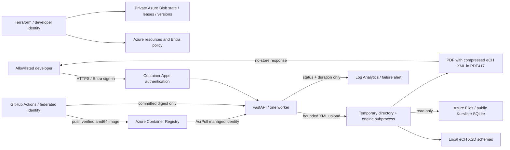

# Architecture and data flow

The current environment is a single-user portfolio MVP in Switzerland North.
Entra terminates authentication before traffic reaches the API. The application
does not implement user accounts or accept identity headers from public clients.
One Uvicorn worker and at most one replica bound engine concurrency; another
upload returns 503 with a retry hint. A 12 MiB whole-request limit bounds multipart
spooling, with a separate 10 MiB XML-file limit. Jobs time out after 120 seconds.

The engine is isolated in a subprocess with empty per-job configuration and
identifier files. Broker XML and PDFs live in a temporary directory removed
after completion or failure; they are not written to Azure Files or application
logs. Request cancellation does not remove files underneath the running worker.
The PDF is returned with `Cache-Control: no-store`; the client controls downloaded
copies. Reference data is public and mounted read-only, separately from the image.

`/health` verifies process responsiveness. `/ready` verifies nonempty files for
configured years and required schemas; it does not scan a 551 MiB database over
SMB or prove calculation correctness. Processing and import checks provide that
additional evidence. Scale-to-zero allows idle runtime shutdown; the first
authenticated request after an idle period can be slower.

Terraform owns infrastructure and desired image configuration. The manual image
deployment workflow reads the committed digest and changes only the runtime image
through Azure CLI. A subsequent Terraform plan refreshes state and should have no
image drift. Infrastructure changes remain reviewed local Terraform operations;
the release identity cannot access the sensitive Terraform state container.
